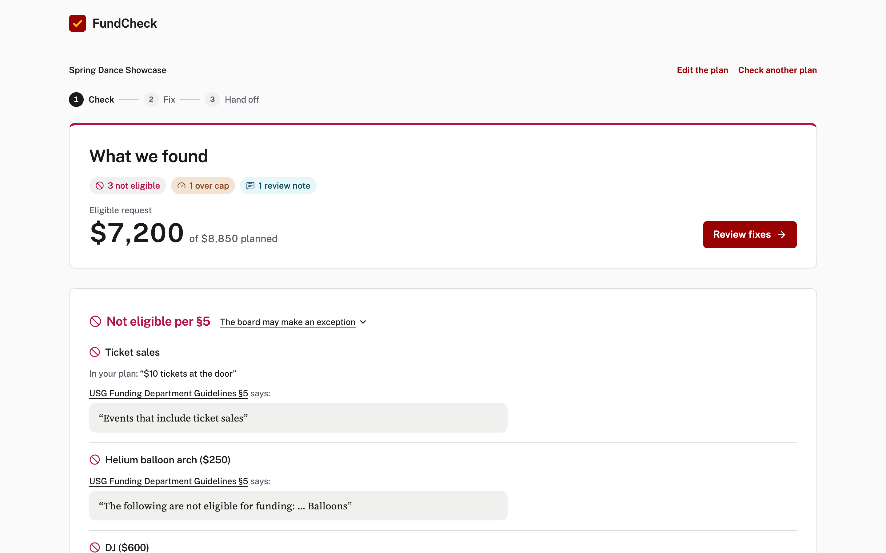
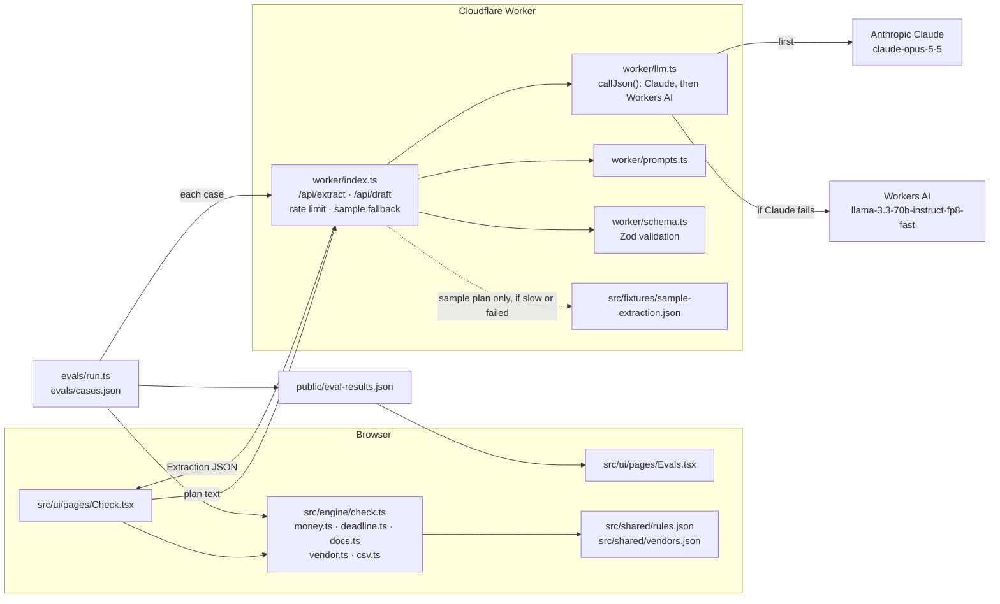

# FundCheck

FundCheck pre-checks a USC student organization's USG Funding Department application. An officer pastes an event plan in plain words, and FundCheck shows which items USG's Guidelines don't fund (each with USG's own quote), the money against every cap, which fund to apply to, a deadline estimate, the documents to attach, and drafted form answers plus a budget CSV. The on-campus events USG funds can't sell tickets and must be open to all students, so every application that comes back late or incomplete is one fewer free event for every Trojan. FundCheck exists so the application a Funding Director opens is already complete and inside the rules.

**Live:** https://fundcheck.mayhu733.workers.dev (no login; try the Bovard dance showcase sample)
**Accuracy page:** https://fundcheck.mayhu733.workers.dev/evals (the headline score; every case and result is in `evals/` and `public/eval-results.json`)



## Run it locally

```bash
npm i
```

Put a Claude API key in `.dev.vars` (git-ignored) as `ANTHROPIC_API_KEY=...`. Without it, the worker falls back to Cloudflare Workers AI, which needs `wrangler login`.

```bash
npm run dev:worker
```

That starts the Worker and its `/api` routes on port 8787. In a second terminal:

```bash
npm run dev
```

That starts the page on http://localhost:5173, with `/api` proxied to 8787. Add `?fixture=1` to the URL to see the sample result without calling any model.

```bash
npm test
```

```bash
npm run evals -- --url https://fundcheck.mayhu733.workers.dev
```

The eval runner defaults to `http://localhost:8787`. Add `--only e01,e06` to run a subset (partial runs don't overwrite the results file).

## Architecture

One Cloudflare Worker serves the React page as static assets plus two JSON endpoints. The rules engine is plain TypeScript that runs in the browser and in the eval runner and never calls a model.



The shared types (money in integer cents, dates as `YYYY-MM-DD`) are in `src/shared/contracts.ts`.

## What the AI does, and what the code does

| The model (`claude-opus-5-5`, low effort) | Plain TypeScript (`src/engine/`) |
|---|---|
| Reads the free-text plan into line items and event facts (date, attendance, on campus, ticketed, travel) | All dollar math: the $4,000 venue and personnel cap, the $35 per person food limit, the $8,000 yearly cap, the $400 per night lodging limit, and the eligible request, capped by what is left of the $8,000 once the officer says what the org already received |
| Matches each item to rule IDs from a fixed list, with high or low confidence and a one-line reason ("DJ $600" → "Payments to talent or performers") | The deadline estimate (academic weeks, holidays and breaks from USC's academic calendar) and the blackout-date check |
| Picks one of the four funds | The document checklist and the exact file names |
| Drafts the form's free-text answers and the budget justifications, with bracketed placeholders such as "[your organization's mission]" for facts the plan doesn't give | Vendor check: plain string matching against both tabs of USG's vendor sheet (207 rows). This is not AI. |
| | The budget CSV in USG's template columns |

Every flag carries a rule ID internally, and the page renders USG's quote from `src/shared/rules.json` (version `guidelines-2026-10-21.1`, 51 rules), never text from the model.

## Security and privacy

- **No storage.** FundCheck has no database and keeps nothing. The plan is sent to the model for that one call. The Worker logs token counts and error codes, never the plan text.
- **No traveller PII.** FundCheck never asks for dates of birth, USC IDs or phone numbers. It only reminds the officer that USG's form needs them.
- **Injection-safe prompt.** The plan is passed inside tags as untrusted data, and the system prompt tells the model to ignore instructions inside it. The output must match a Zod schema, and any rule ID outside the allowed list is dropped, so pasted text can't add a rule or change a quote.
- **Low confidence becomes a question.** An unsure match shows as an Ask chip for the officer, never as a flag.
- **Keys.** `ANTHROPIC_API_KEY` is a Wrangler secret in production and lives in the git-ignored `.dev.vars` locally. No key is in the repo.
- **Rate limit.** 20 model calls per minute per IP, counted per Worker instance.

## Eval results

Hand-written event plans in `evals/cases.json`, each labelled with the rules it must and must not trigger, run through the live `/api/extract` and then the rules engine. Many are phrased indirectly ("entertainment by" a stage name for a paid DJ, Mylar letters for balloons, robotaxi rides for rideshare). Some are clean plans full of decoys, and some are ambiguous plans where the right answer is an Ask chip, not a flag.

**Latest run:** FundCheck checked 96 of 100 test plans correctly, every one scored on a Claude answer (a case served by the fallback is re-run, never scored). Every case, its labels and its result are in `evals/` and `public/eval-results.json`.

Limits: these are test plans we wrote by hand, not real applications, so the score is a check, not a benchmark. The sample plan (e01) is close to the prompt's few-shot examples. Scoring details are in `evals/README.md`.

## Not built, and why

- **Suggesting other funding sources.** USG's Guidelines list "RSO receiving funding from another University income source" among reasons an application can be turned down, so suggesting other sources without care could hurt an application. Cut first.
- **A reviewer view for Funding Directors.** It needs the Funding Department's input on what reviewers want to see. The officer-side check came first.
- **Reading quotes from PDFs or images.** FundCheck takes pasted text only. Parsing uploads adds a failure point that the golden path didn't need for the hackathon.

## Notes for the Funding Department

While building the rules table we found a few places where USG's documents word the same rule differently. They're collected, with sources, in [submission/form-notes.md](submission/form-notes.md), as a short list for the next Guidelines revision.

## Built with

TypeScript, React 18, Vite 6, Tailwind CSS v4, Zod 4, Vitest, Cloudflare Workers with static assets, Cloudflare Workers AI, and the Anthropic SDK. The code was written during the hackathon (Nov 14 to 15, 2026) with Claude Code as the coding assistant. The colours follow the U.S. Web Design System, with a small USC accent.
